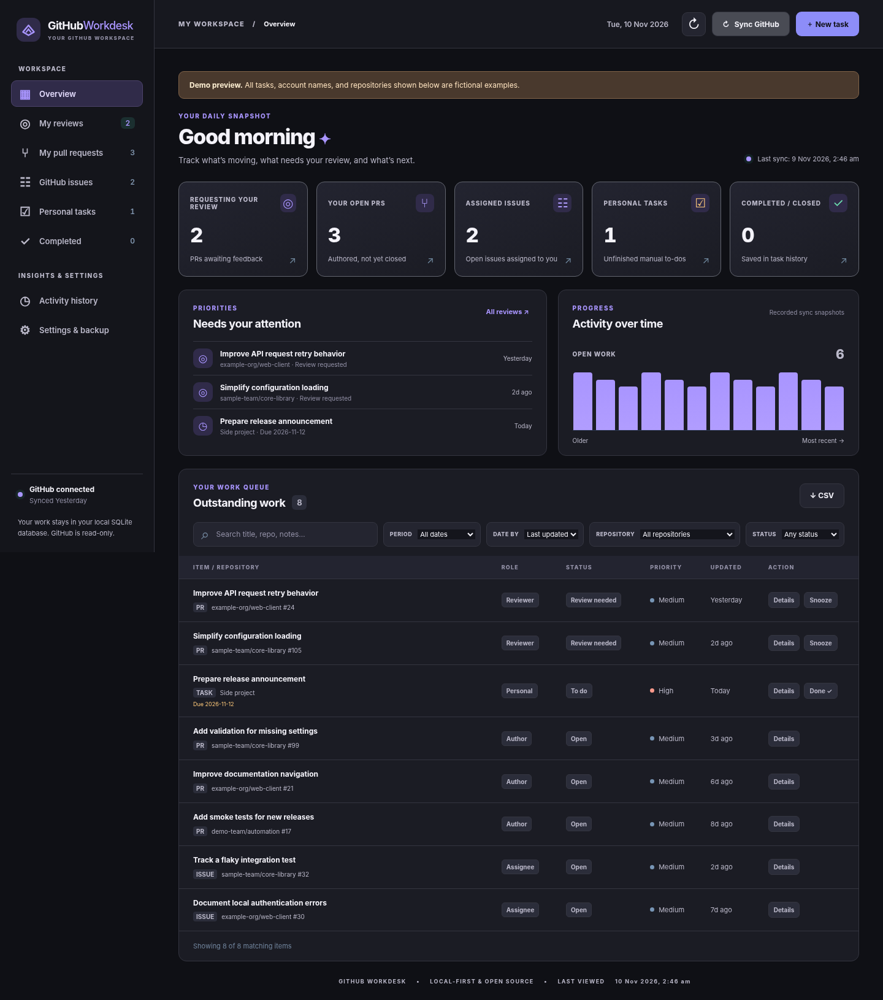

# GitHub Workdesk

**A local-first, open-source dashboard for managing your GitHub pull requests, requested reviews, issues, and personal to-dos.** Runs in your browser; your notes and synced metadata stay on your own machine. No hosted Workdesk account, Python dependencies, or server subscription required.



## What it does

- **PR tracking:** authored open and draft PRs, and recently closed or merged PRs.
- **My contributions:** active and historical PRs, authored/co-authored commits, submitted reviews, contribution evidence, private notes, and followed PR updates.
- **Review queue:** requests for your review; removed requests are not automatically assumed to have been reviewed.
- **Issues:** assigned issues and issues you created.
- **Personal tasks:** title, priority, due date, notes, links, completion status and history, independent of GitHub.
- **Filters:** repository, text, time range, completion state and role.
- **Activity:** timestamped task updates and work-count snapshots.
- **Appearance:** Follow System, GitHub Light, GitHub Dark, Linear-inspired Dark, Catppuccin Mocha, Nord, and Dracula; saved in your local database and included in backups.
- **Local backups:** daily automatic snapshots, a “Save backup on this Mac” button, and JSON/CSV/SQLite downloads.
- **Notifications:** a local inbox for mentions, replies, assignments, and review requests; automatic checks every minute, unread badges, and desktop alerts. Optional macOS background checks continue after closing Workdesk.
- **Reminders:** optional macOS scheduled daily sync and desktop notification (Linux/Windows users can sync manually or schedule the CLI command themselves).

GitHub operations are **read-only**. You can edit your own tasks and local tracking notes; Workdesk will not post comments, edit issues, merge PRs, or change repositories.

## Requirements

- Python 3.10 or newer (standard library only)
- A GitHub account and network connection for GitHub synchronization
- [GitHub CLI (`gh`)](https://cli.github.com/) signed in with `gh auth login` **or** a suitable `GH_TOKEN` / `GITHUB_TOKEN` environment variable

## Install and start

```bash
git clone https://github.com/YOUR_USERNAME/github-workdesk.git
cd github-workdesk
python3 app.py
```

Or download the source ZIP and run `python3 app.py` from its folder. On macOS, you can also double-click `start.command` (after approving the file in macOS if prompted). The app opens **http://127.0.0.1:8765**.

1. Sign in to your own GitHub account with `gh auth login` (skip this if an authorized token is already in your environment).
2. Click **Sync GitHub**. Your GitHub username is detected automatically. No code edits are needed.
3. Use **Settings & backup** to optionally pin a GitHub username, set focus organizations, choose your preferred theme, and configure history lookback.
4. Create local tasks with **New task**. GitHub sync does not overwrite your private notes or local priorities.

When **Focus organizations** is empty, the app shows work from *all* accessible repositories. To narrow the list, enter an organization or repository owner in Settings, then select the **Focus organizations** filter. GitHub access is limited by your authenticated account permissions; private repositories require appropriate authorization and, when necessary, organization SSO approval.

## Command-line commands

```bash
python3 app.py                   # local web UI
python3 app.py --port 8799       # custom port
python3 app.py check-notifications  # one notification check (respects the next allowed poll time)
python3 app.py install-notifications  # macOS: check even when Workdesk is closed
python3 app.py remove-notifications   # macOS: remove background checks
python3 app.py backup            # save a complete backup in your local data folder
python3 app.py sync              # one-time GitHub sync
python3 app.py sync --notify     # sync and notify (macOS)
python3 app.py install-reminder --time 09:00  # macOS only
python3 app.py remove-reminder   # macOS only
python3 -m unittest discover -s tests -v
node --test tests/test_*_ui.js  # contributor UI tests; Node 18+
```

The macOS scheduled sync runs while you're logged in and the system executes the LaunchAgent. It does not require the browser page to stay open. On other operating systems, notification checks run with the Workdesk server; browser desktop alerts require permission and an open Workdesk tab. The daily summary and background scheduling are macOS-only.

## My contributions

Open **My contributions** after **Sync GitHub**. **Active** shows open PRs you helped with; **History** contains merged/closed PRs and standalone commits. Filter by repository, role or your contribution date; sort by the latest PR activity or your own latest contribution. Discussion-only participation is optional. A review request alone does not count as a submitted review.

Expand **Your contribution** to see the exact commit/review links behind each badge and add private notes. **PR author**, **Code contributor**, **Co-author**, **Committer** and **Reviewer** describe distinct kinds of involvement. Co-author credits match email addresses in trailing `Co-authored-by` metadata; names alone are not used. Previously recorded evidence is retained and labelled if later removed by a force-push or review deletion. “Reviewed” reflects a current-head approval, not a guarantee that all merge requirements are satisfied.

Discovery combines authored/reviewed/commented PR searches, default-branch commit searches and commit-to-PR associations. Because [GitHub commit search only covers default branches](https://docs.github.com/en/search-github/searching-on-github/searching-commits), Workdesk also scans open PRs in discovered repositories. **Settings → Contribution discovery** accepts extra `owner/repository` entries for shared work elsewhere, plus your older/alternate commit emails. Verified GitHub emails are used when existing credentials permit access; no additional permission is requested automatically. The configured history window controls initial historical discovery; saved evidence remains available afterward.

A sync checks up to 30 repositories for open PRs, 200 candidate PRs and 500 API requests; explicit extra repositories are prioritised. Commit-to-PR association checks are limited to 100 commits or a smaller available request budget. Search results, API errors and GitHub's 250-commit PR endpoint limit may leave gaps. **Discovery coverage** separates coverage notes from requests that failed; previously saved work and private notes are preserved. Optional email access and scan limits produce an informational **Synced with limited contribution coverage** notice. Timeouts, authentication failures and other failed requests appear under **Requests to retry**, with a Retry sync action. All reasons are available in the expanded report. Existing saved sync reports are reclassified when upgrading; genuine failures are retained. CLI sync exits successfully for coverage-only limits. The section is a record of discovered contributions, not an exhaustive GitHub contribution audit.

**Follow updates** tracks a PR through the notification watcher even when GitHub does not send you a participating thread. It checks the PR's latest activity timestamp while automatic notification checks run, and sends updates to the same local inbox and desktop alert system. Up to 50 PRs can be followed. It does not subscribe you on GitHub. Notes, follow preferences, evidence and discovery state are included in local JSON/SQLite backups and separated by GitHub account.

## Notifications

Automatic notification checks are enabled by default while the Workdesk server runs. Open **Notifications** to see your inbox, or **Settings & backup → Notifications** to pause checks, change the interval, or disable desktop alerts. The first successful check imports existing unread threads quietly; later new or updated threads trigger an alert. Read status in Workdesk is local and never changes GitHub. Repository filters on the work queue do not hide notifications.

The watcher uses GitHub's participating notifications: mentions (including team mentions), replies in conversations you participate in, assignments, and review requests. “Messages” means GitHub discussion/comment activity reported by this feed, not email, chat, or direct messages. Threads combine multiple updates between checks; the inbox links to the GitHub conversation. Delivery depends on your GitHub notification subscriptions and access. It is polling, not instant push: normally about a minute while awake and online, plus any GitHub delivery delay. GitHub's `X-Poll-Interval` and rate-limit backoff may extend this. Errors appear in Notifications and Settings; checks retry automatically without discarding the last successful checkpoint.

GitHub's [Notifications API](https://docs.github.com/en/rest/activity/notifications) requires a classic token with `notifications` or `repo` scope and does not support fine-grained tokens. If your CLI credentials need the scope, run `gh auth refresh -h github.com -s notifications`. Private organization access may also need SSO authorization. Credentials stay in the environment or GitHub CLI credential store.

On **macOS**, desktop alerts use `osascript`; allow notifications from Script Editor / osascript in System Settings and check Focus settings if alerts do not appear. Select **Enable background checks** to install a per-user LaunchAgent that runs while you are logged in, even after closing the browser and server. It uses `gh auth login` credentials; environment tokens are never saved to its plist. Remove it with **Remove background checks** or `python3 app.py remove-notifications`. The foreground server continues checking until paused in notification settings.

On **Linux and Windows**, select **Allow browser alerts** and leave the tab open for desktop notifications (browser support varies). The local inbox works without browser notification permission. All platforms retain unread threads and deduplicate updates across restarts. Only the newest 200 threads are displayed at once, unread first; marking displayed threads read reveals older unread threads.

## Saving everything locally

Local mode is the default. No Render account, hosting setup or subscription is needed.
Run `python3 app.py` or double-click `start.command`.

Every successful task/note/settings save, notification update and GitHub sync writes
to your local SQLite database. Saved records remain when you close the browser,
restart Workdesk, or restart your computer. This includes the GitHub records
Workdesk has discovered, manual tasks, priorities, due dates, bookmarks, snoozes,
notes, contribution evidence/follow preferences, notification history/read status,
sync reports, activity history and appearance/discovery/notification settings.
Choose **Save** for forms; unfinished edits are not committed automatically.
An existing browser theme is migrated into the database on first load.

**Settings & backup → Saved on this Mac** shows the actual database path, the latest
backup and its folder. **Save backup on this Mac** creates a consistent copy of the
whole database directly under `backups/` in the data folder. **Open data folder**
reveals it in Finder. JSON, CSV and SQLite downloads are still available; CSV is a
task list, while SQLite contains the whole saved workspace.

Automatic backups are enabled in local mode. A backup is made at startup if no
automatic copy exists from the last 24 hours; checks continue every 10 minutes
while the local server runs. CLI sync and background notification checks also
check whether a daily backup is due. No backup job runs while the Mac is asleep
or off; it catches up when Workdesk next runs. Keep the latest seven automatic
copies; manual copies are never pruned. A backup failure is shown in Settings
and does not block ordinary saves or sync.

Backups contain Workdesk data, not GitHub credentials, repository clones, or
unsaved form edits. GitHub authentication remains in your local CLI credential
store or environment. These backups are on the same computer; copy an export
to your normal backup storage if you need protection from loss of the device.

To restore a SQLite backup, stop Workdesk and its scheduled checks, keep a copy of
the existing data folder, and use the backup as `workdesk.sqlite3` in a **new** data
folder. Start with `WORKDESK_DATA_DIR=/absolute/path/to/new-folder python3 app.py`.
Using a new folder avoids mixing an old database with leftover SQLite WAL files.
Re-enable scheduled checks for that data folder if needed. The original data stays
available until you choose to remove it.

Optional hosted code is retained separately for future use; it is not started by
local mode and no deployment is required. See [HOSTING.md](HOSTING.md) only if you
later choose to revisit hosting.

## Data and privacy

By default, Workdesk runs locally. Opening or publishing this **source repository** does not publish your GitHub work data. Local mode stores data in a per-user SQLite database:

| OS | Default database location |
| --- | --- |
| macOS | `~/Library/Application Support/GitHub Workdesk/workdesk.sqlite3` |
| Linux | `~/.local/share/github-workdesk/workdesk.sqlite3` |
| Windows | `%LOCALAPPDATA%/GitHub Workdesk/workdesk.sqlite3` |

Override with `WORKDESK_DATA_DIR=/custom/path`. Local `app.py` listens on `127.0.0.1`; do not expose that server to the internet. Optional `cloud.py` provides authenticated single-owner hosting behind HTTPS. In hosted mode, work records and encrypted GitHub credentials reside on your chosen host, and requests to GitHub originate there. Both modes use GitHub read-only. See [SECURITY.md](SECURITY.md) and [HOSTING.md](HOSTING.md).

**Migration:** If you previously used an older, individually customized release, its SQLite database may have been stored in a differently named directory. This clean public release starts with its own database to avoid mixing installations. Back up the old database before considering any manual migration.

## Publishing your own fork or copy

To create a *new* repository from a downloaded source folder, install Git and GitHub CLI, authenticate with `gh auth login`, then run:

```bash
bash publish-to-github.command --public
```

This script detects your **own** GitHub username and asks you to explicitly confirm publication. It does not contain anyone else's GitHub identity. Use `--private` instead for a private repo. If a repository already exists at the target, the script refuses to overwrite it. Standard GitHub fork/clone flows are better for an existing repository.

## Contributing and license

Suggestions, issues and pull requests are welcome; see [CONTRIBUTING.md](CONTRIBUTING.md). See [ROADMAP.md](ROADMAP.md) for proposed future enhancements. Licensed under the [MIT License](LICENSE). This is an independent community project and is not affiliated with or endorsed by GitHub.
